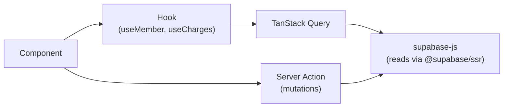
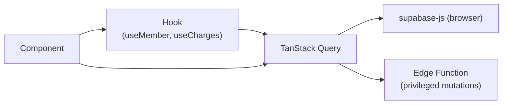

# Frontend network layer (standard)

> **Standard** — companion to [frontend.md](frontend.md).
> **Related ADRs:** [0014](../adr/0014-tokens-in-httponly-cookie-no-localstorage.md), [0015](../adr/0015-idempotency-keys-mandatory.md), [0030](../adr/0030-supabase-as-baas-with-server-actions.md).

How every Shesa app talks to Supabase: security, speed, caching, idempotency, and what the frontend is responsible for. Tuned for Cameroonian conditions — flaky 3G, shared devices, metered data, Mobile Money payments, and intercontinental hop to Frankfurt.

---

## 1. Architecture — two layers, one client

### For Next.js apps



- **Reads:** Server Components call supabase-js directly via `@supabase/ssr`. Client components use TanStack Query hooks that wrap supabase-js.
- **Mutations:** Server Actions own them — that's where idempotency keys, policy checks, and the error envelope live.
- **Never** call supabase-js directly inside a component body. Wrap in a hook (reads) or a Server Action (writes).

### For plain React (Vite) apps



- **Reads:** TanStack Query hooks wrap supabase-js. RLS enforces access.
- **Mutations needing policy / idempotency:** call an Edge Function instead of supabase-js directly.

---

## 2. The Supabase client(s)

`packages/supabase` exports three factories:

| Factory                          | Used in                                       | Has service-role |
| -------------------------------- | --------------------------------------------- | ---------------- |
| `createBrowserClient()`          | Client components, plain React apps           | No (anon key)    |
| `createServerClient(cookies)`    | Server Components, Server Actions, Route Handlers | No (anon key, JWT from cookie) |
| `createServiceRoleClient()`      | Server Actions / Edge Functions only          | **Yes (bypasses RLS)** |

- **Hard rule:** `createServiceRoleClient` is import-banned in `apps/*` client code and in `packages/ui`. Only Server Actions / Edge Functions ever import it.
- **One configured client per scope per request.** Don't construct ad-hoc clients in components.

---

## 3. Request headers / context

Every Server Action / Edge Function call carries:

| Field                 | Purpose                                                                            |
| --------------------- | ---------------------------------------------------------------------------------- |
| Auth (cookie)         | Supabase Auth session — see [ADR-0014](../adr/0014-tokens-in-httponly-cookie-no-localstorage.md) |
| `traceId` (uuid)      | End-to-end tracing — surfaced on errors, support quotes it                         |
| `idempotencyKey`      | On mutations that must not run twice — see §5                                      |
| `App-Source` (header) | Which Shesa app called (audit + analytics)                                         |

A small wrapper around `fetch` (for Edge Function calls) and a Server Action middleware inject these uniformly.

---

## 4. Security

### Token storage — Supabase Auth cookies, never `localStorage`

- Supabase Auth's cookie-based session via `@supabase/ssr` — refresh token in an **httpOnly, Secure, SameSite cookie** scoped to the Shesa root domain (e.g. `.shesa.app`). JavaScript never touches the refresh token.
- For plain React apps: configure the Supabase client with a cookie storage adapter, not the default `localStorage` adapter.
- **`localStorage` for auth tokens is BANNED.**
- Shared cookie domain gives **SSO across all Shesa subdomains** (web / exco / finance / connect) for free.

### Service-role key never in the browser

The service-role key bypasses RLS. It is used **only** inside Server Actions, Route Handlers, and Edge Functions. Lint rule enforces.

### Idempotency keys for payments / critical mutations

For every mutating action that must not run twice — pay a charge, registration fee, pay-on-behalf — the client **generates a UUID once per user action and reuses it across all retries**. The Server Action / Edge Function dedupes via `core.idempotency_keys`. See [ADR-0015](../adr/0015-idempotency-keys-mandatory.md).

### Clear everything on logout

Purge the TanStack Query cache, the Zustand store, and any persisted / IndexedDB cache. **Shared phones and cybercafés are common in Cameroon** — if logout doesn't wipe, the next person sees the previous user's data.

### Never log sensitive data

No tokens, no PII in URLs (they hit access logs), console, or Sentry. Scrub before sending.

---

## 5. Query speed — Cameroon-tuned

The dominant cost is **round-trip latency** to Frankfurt (~150–300ms each from Cameroon). The frontend's job is **fewer round-trips**, not just faster ones.

- **Serve cache first, revalidate in background** (TanStack Query default). User sees data instantly; freshness catches up.
- **Deduplication** — TanStack Query collapses identical in-flight requests. Don't bypass by calling supabase-js directly inside a component.
- **Prefetch on intent** — `queryClient.prefetchQuery` on row hover or route-enter so the detail page is already loaded.
- **Parallelize, never waterfall** — fire independent queries together.
- **Lean payloads** — use Supabase's `.select('col1, col2, nested(col3)')` to fetch only needed columns; paginate; use `useInfiniteQuery` for feeds. Smaller payloads = faster *and* cheaper for users on metered data.
- **Debounce** search inputs (~300ms).
- **Optimistic updates** for mutations so actions feel instant.
- **Lazy queries** — `enabled: false` until needed.

---

## 6. Caching

### Layers

| Layer                       | Holds                  | Notes                                                |
| --------------------------- | ---------------------- | ---------------------------------------------------- |
| TanStack Query (memory)     | Server state           | Primary cache; staleTime tiers below                 |
| Persisted cache (IndexedDB) | Query snapshot         | Optional per app; instant load on return, offline    |
| Service worker (Workbox)    | Assets + select GETs   | For installable / offline apps                       |
| Cloudflare CDN              | Static + cacheable GETs| Edge-close to Cameroonian users                      |

### staleTime tiers (set per query)

```ts
export const STALE = {
  static:   1000 * 60 * 60, // reference data (positions, sectors): 1h
  standard: 1000 * 60 * 2,  // dashboards, lists: 2m
  live:     0,              // balances, payment status: always revalidate
};
```

### Query-key factory (the only place keys are built)

Consistent keys make cache invalidation reliable — a typo'd key is a silent stale-data bug.

```ts
export const memberKeys = {
  all: ['members'] as const,
  list: (f: MemberFilters) => [...memberKeys.all, 'list', f] as const,
  detail: (id: string) => [...memberKeys.all, 'detail', id] as const,
};

// after a mutation:
queryClient.invalidateQueries({ queryKey: memberKeys.all });
```

### Optimistic update pattern

```ts
useMutation({
  mutationFn: payCharge,
  onMutate: async (vars) => {
    await queryClient.cancelQueries({ queryKey: chargeKeys.detail(vars.chargeId) });
    const prev = queryClient.getQueryData(chargeKeys.detail(vars.chargeId));
    queryClient.setQueryData(chargeKeys.detail(vars.chargeId), markPaid(prev, vars));
    return { prev };
  },
  onError: (_e, vars, ctx) =>
    queryClient.setQueryData(chargeKeys.detail(vars.chargeId), ctx.prev),
  onSettled: (_d, _e, vars) =>
    queryClient.invalidateQueries({ queryKey: chargeKeys.detail(vars.chargeId) }),
});
```

---

## 7. Resilience on flaky networks

```ts
new QueryClient({
  defaultOptions: {
    queries: {
      staleTime: STALE.standard,
      gcTime: 1000 * 60 * 30,
      refetchOnWindowFocus: false,
      retry: (count, err) => isRetryable(err) && count < 3,
      retryDelay: (i) => Math.min(1000 * 2 ** i, 30_000) + Math.random() * 250,
    },
    mutations: { retry: 0 }, // retry mutations ONLY with an idempotency key
  },
});
```

- Retry **idempotent reads** with exponential backoff + jitter. Never blindly retry mutations — only retry when an `idempotencyKey` makes it safe.
- **Offline state:** detect connection loss, show it honestly, pause queries, and **queue critical mutations** (e.g. a recorded cash payment) to flush on reconnect.
- **4xx never retries.** Retrying a validation error just hammers Supabase.

---

## 8. Client state with Zustand

- Zustand holds **client-only state**: theme, active filters, UI toggles, the currently-selected Branch / Chapter context, anything that isn't fetched from Supabase.
- **Never copy Supabase responses into Zustand.** TanStack Query owns server state; mixing them creates two sources of truth that drift.
- One store per concern (`useSessionStore`, `useFilterStore`) — not a single megastore.
- Persist sparingly. The theme can persist to `localStorage`; the active filter set probably shouldn't.

---

## 9. The frontend responsibility checklist

What every feature must do — review on each PR:

- [ ] Component calls a hook or a Server Action, never supabase-js directly.
- [ ] Server state in TanStack Query, client state in Zustand — no overlap.
- [ ] Uses the query-key factory; invalidates the right keys after mutations.
- [ ] Sets the correct `staleTime` tier for the data's volatility.
- [ ] Handles **loading, error, and empty** states explicitly — no silent failures.
- [ ] Mutations are optimistic with rollback where the UX benefits.
- [ ] Payment / critical mutations carry a stable `idempotencyKey` reused across retries.
- [ ] Search inputs debounced; lists paginated; only needed columns requested.
- [ ] Prefetches the likely-next data on intent.
- [ ] No tokens in `localStorage`; relies on Supabase Auth cookies.
- [ ] No sensitive data in URLs, logs, or Sentry.
- [ ] Logout purges TanStack Query + Zustand + persisted cache.
- [ ] Offline is detected and surfaced; critical writes queue and retry.

---

## 10. Defaults summary

| Concern               | Default                                                                |
| --------------------- | ---------------------------------------------------------------------- |
| Supabase client       | Per-scope factory from `packages/supabase`; no ad-hoc construction     |
| Server cache          | TanStack Query, SWR, tiered staleTime                                  |
| Client state          | Zustand, one store per concern                                         |
| Auth (web)            | Supabase Auth cookie-based session via `@supabase/ssr`                  |
| Token refresh         | Handled by Supabase Auth automatically                                  |
| Mutations             | Optimistic + rollback; idempotency key on critical writes              |
| Retries               | Reads: backoff + jitter ×3; mutations: only with idempotency key       |
| Tracing               | `traceId` on every server action, surfaced on errors                   |
| Logout                | Full cache + state purge                                                |
