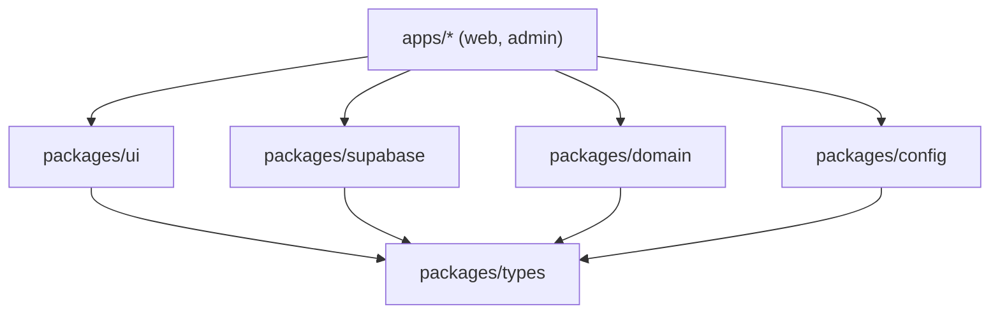

# Frontend conventions (standard)

> **Standard** — living convention for Shesa's frontend apps and packages.
> **Related ADRs:** [0010](../adr/0010-monorepo-package-layout-and-dep-direction.md), [0014](../adr/0014-tokens-in-httponly-cookie-no-localstorage.md), [0021](../adr/0021-monorepo-pnpm-turborepo.md), [0027](../adr/0027-utils-and-validators-packages.md), [0030](../adr/0030-supabase-as-baas-with-server-actions.md).

The standard every Shesa app and package follows. Written so a new dev can read one section and know exactly where code goes, what to name it, and why. Rules here are enforced by tooling ([§7](#7-enforcement)), not goodwill.

---

## 1. Package map & responsibilities

Apps and packages each own exactly one concern (SRP at the package level).

### Apps

| App          | Stack   | Purpose                                                                                                            |
| ------------ | ------- | ------------------------------------------------------------------------------------------------------------------ |
| `apps/web`   | Next.js | Public website — renders CMS-authored content and the AGM flows. Fully public; no auth-gated route.                |
| `apps/admin` | Next.js | Governance console at `admin.shesaconnect.com`, hosting three personas: Exco, Finance, Editor. Owns its own login. |

Two apps, both Next.js. `apps/auth`, `apps/exco`, `apps/finance` and `apps/connect`
were retired by [ADR-0040](../adr/0040-consolidated-admin-app-per-app-auth.md), which
merged the two Vite SPAs into `apps/admin` and moved authentication into it.

### Packages — runtime

| Package             | Owns                                                                                                                            | Must NOT contain                                                  |
| ------------------- | ------------------------------------------------------------------------------------------------------------------------------- | ----------------------------------------------------------------- |
| `packages/ui`       | shadcn/ui components (copy-pasted in), Tailwind config, shared CSS variables, `cn()` helper                                     | Domain logic, Supabase imports, app-specific UX                   |
| `packages/types`    | Cross-package shared domain types (TypeScript)                                                                                  | Runtime code                                                      |
| `packages/domain`   | Zod schemas, domain errors, business-rule helpers, policy module, generic utils & validators                                    | UI, Supabase client construction, app-specific code               |
| `packages/supabase` | Supabase client factories (browser, server, service-role), generated DB types, cookie config scoped to apex domain, RLS helpers | UI, domain logic                                                  |
| `packages/config`   | Runtime config — Zod-validated env schema, public URL helpers, feature flags                                                    | UI, build-only configs (those live in the tooling packages below) |

### Packages — tooling (build-time only, not in the runtime dep graph)

| Package                  | Owns                                                                                      |
| ------------------------ | ----------------------------------------------------------------------------------------- |
| `packages/eslint-config` | Shared ESLint flat config (base preset + Next preset). Consumed via `extends` / `import`. |
| `packages/tsconfig`      | Shared `tsconfig` bases (base, Next, Node). Consumed via `extends`.                       |

### Where does a type live?

- A Supabase DB row shape → **generated**, comes from `packages/supabase` (`supabase gen types`). Never re-declare it.
- A domain concept used by 2+ packages (e.g. `MembershipStatus`) → `packages/types`.
- A type used only inside one component → next to the component.
- A type used only inside one app → that app's local `types/`.

---

## 2. Dependency direction

Imports flow **one way only — downward**. Enforced by `dependency-cruiser` in CI.

Tooling packages (`packages/eslint-config`, `packages/tsconfig`) are intentionally omitted from this runtime graph — they're consumed at build time via `extends` / preset references, not via JS imports, so `dependency-cruiser` doesn't gate them.

Hard rules:

- **No package imports an app.** Ever.
- **`packages/ui` must not import** `packages/supabase` or `packages/domain`. It stays presentational; data is passed in as props.
- **`packages/types` imports nothing.** It is the root of the type graph.
- **The Supabase service-role key is banned everywhere except Server Actions, Route Handlers, and Edge Functions.** Browser bundles ship the anon key only; RLS enforces access.
  > ⚠️ **Convention only, for now.** Several files carry comments claiming this
  > is "enforced by ESLint `no-restricted-imports`". It is not — the rule was
  > never written, so nothing currently stops `@shesa/supabase/service-role` or
  > `@shesa/config/env.server` being imported into a `'use client'` file, which
  > would put the service-role key and the Resend key into a browser bundle.
  > Landing the rule is tracked as SEC-11.
- A package may only import packages strictly below it in the graph.

---

## 3. shadcn/ui — the component layer

We use **shadcn/ui's copy-paste model** — components live in `packages/ui/src/components/` after `pnpm shadcn add <component>`. They are our code; we own them, we adapt them.

- **Add a component:** `pnpm --filter @shesa/ui shadcn add button` (or whatever the runner alias becomes).
- **Customize:** edit the file in `packages/ui/src/components/` directly. Don't fork — just edit.
- **Tailwind config** lives in `packages/ui/tailwind.config.ts`; apps extend it via `presets:`. CSS variables for theming live in `packages/ui/src/styles/globals.css`.
- **Forms:** shadcn/ui Form + react-hook-form + Zod resolver, with schemas imported from `packages/domain/validators/`.

---

## 4. Atoms vs molecules vs app components

| Tier             | Lives in                 | Knows about                       | Examples                                      |
| ---------------- | ------------------------ | --------------------------------- | --------------------------------------------- |
| Atom / primitive | `packages/ui/components` | Nothing but its own props         | Button, Input, Badge, Avatar (shadcn-shipped) |
| Molecule         | `packages/ui/components` | Only atoms + light internal state | Form, Dialog, Dropdown, Card, Tabs, DataTable |
| App component    | the **app** (`apps/*`)   | Domain data, Supabase, routing    | MemberCard, ChargeRow, BranchSwitcher         |

Test for "does this belong in `packages/ui`?": _Could every Shesa app use it without knowing what a Member or a Charge is?_ If no — it's an app component.

---

## 5. Naming

### 5.1 The rule that matters

**A filename must say what the file is without its directory.**

Everything else here follows from that. The test: if this file appeared alone
in a search result, an editor tab, or a stack trace, would you know what it is?
`charge-matrix-columns.tsx` passes. `types.ts` does not.

This is not a style preference. In September 2026 the repository held 19 files
called `actions.ts`, 19 called `types.ts`, 12 called `data.ts` and 6 called
`slugify.ts`. Every one of them meant something different, and the only way to
tell which was which was to read the path — so fuzzy-find was useless and a tab
strip told you nothing. Worse, near-identical files with identical names is how
[the missing authorization check in eight media actions](../../supabase/migrations/_archive/README.md)
survived review: the ninth copy looked exactly like the eight before it.

### 5.2 Files

| Thing                | Convention                             | Example                                          |
| -------------------- | -------------------------------------- | ------------------------------------------------ |
| Any source file      | kebab-case                             | `charge-matrix-columns.tsx`                      |
| React component file | kebab-case, named export in PascalCase | `member-card.tsx` exporting `MemberCard`         |
| Widget / view file   | `<entity>-<concern>[-<subconcern>]`    | `branch-import-issue-row-editor.tsx`             |
| `lib/` loader        | **verb**-first                         | `load-charge-detail.ts`, `build-matrix-shape.ts` |
| Server Action file   | `<entity>-actions.ts`                  | `charge-actions.ts`, `photo-actions.ts`          |
| Type file            | `<entity>-<concern>-types.ts`          | `charge-detail-types.ts`                         |
| Hook                 | `use-<thing>.ts`                       | `use-charge-columns.ts`                          |
| Folder               | kebab-case                             | `member-profile/`                                |
| Package              | `@shesa/kebab-case`                    | `@shesa/ui`                                      |

Two sub-patterns the codebase already converged on, worth keeping:

- **`lib/` is verb-first, `widgets/` is entity-first.** A `lib/` module _does_
  something (`load-…`, `build-…`, `resolve-…`); a `widgets/` module _is_
  something (`charge-hero`, `branches-columns`).
- **Singular for detail scope, plural for list scope.** `branch-detail-toolbar.tsx`
  sits under `[slug]/`; `branches-columns.tsx` sits over the list.

### 5.3 Banned filenames

Bare, context-free names. Each has a compliant form:

| Don't                               | Do                                                  |
| ----------------------------------- | --------------------------------------------------- |
| `actions.ts`                        | `charge-actions.ts`                                 |
| `types.ts`                          | `charge-detail-types.ts`                            |
| `data.ts`                           | `strategic-plan-content.ts`                         |
| `helpers.ts`                        | `charge-matrix-helpers.ts`                          |
| `loader.ts`                         | `load-gallery-albums.ts`                            |
| `form.tsx`                          | `network-form.tsx`                                  |
| `list-view.tsx` / `detail-view.tsx` | `branches-list-view.tsx` / `branch-detail-view.tsx` |
| `slugify.ts`                        | none — import from `@shesa/domain/utils`            |

**Exempt: filenames the App Router owns.** `page.tsx`, `layout.tsx`, `route.ts`,
`middleware.ts`, `loading.tsx`, `error.tsx`, `not-found.tsx`, `template.tsx`,
`default.tsx`, `sitemap.ts`, `robots.ts`, `opengraph-image.tsx`. The framework
resolves these by name; the directory _is_ the identifier. Roughly 100 files.

**Exempt: `packages/ui/src/components/`.** One file per design-system
primitive, named after the component it exports — `button.tsx`, `dialog.tsx`,
`form.tsx`. There the bare noun _is_ the identifier, it matches upstream
shadcn, and the whole directory follows the pattern, so renaming one file to
satisfy 5.1 would only make it the odd one out.

`pnpm check:filenames` enforces all of the above, and runs in CI ahead of lint.

### 5.4 Identifiers

| Thing            | Convention                      | Example                        |
| ---------------- | ------------------------------- | ------------------------------ |
| Boolean prop     | `is` / `has` / `can` / `should` | `isLoading`, `canSubmit`       |
| Interface / type | PascalCase, no `I` prefix       | `Member`, not `IMember`        |
| Constant         | SCREAMING_SNAKE_CASE            | `MAX_BULK_IMPORT_ROWS`         |
| CSS variable     | semantic, kebab-case            | `--color-primary`, `--space-4` |

> **Changed 2026-09-03.** This section used to mandate `PascalCase.tsx` for
> components and explicitly bless `actions.ts`. No file in the repository has
> ever been PascalCase, and `actions.ts` was the single worst offender against
> 5.1 — so the standard described a codebase that did not exist while
> permitting the thing that most needed banning. It now matches the code, and
> the code is being brought to match it.

---

## 6. SRP / DRY

- **One file, one responsibility.**
- **A component either presents or orchestrates, never both.** Atoms / molecules present. Data fetching, mutations, and policy live in hooks (for client) and Server Actions (for Next).
- Layering for Next apps: **Component → Server Action → supabase-js**. For React apps: **Component → TanStack Query hook → supabase-js**. A component never imports the Supabase client directly inside its body.
- **A package does one job.** New cross-cutting concern → consider a new package (and an ADR); don't bolt it onto an unrelated one.

DRY — single source of truth per concern:

| Concern                | Single source                                                   |
| ---------------------- | --------------------------------------------------------------- |
| DB row shapes          | `packages/supabase/types.gen.ts` (regenerated after migrations) |
| API contracts          | Zod schemas in `packages/domain/validators/`                    |
| Domain types           | `packages/types/`                                               |
| UI components          | `packages/ui/`                                                  |
| Currency / date format | `packages/domain/utils/`                                        |
| Permission checks      | `packages/domain/policy/`                                       |

**The senior caveat — don't over-DRY.** Three similar lines is cheaper than a premature abstraction. Rule of three: abstract on the _third_ genuine repetition.

---

## 7. Enforcement

| Rule                                        | Enforced by                                                       |
| ------------------------------------------- | ----------------------------------------------------------------- |
| Dependency direction (§2)                   | `dependency-cruiser` in CI — fails the build on illegal imports   |
| `packages/ui` not importing supabase/domain | ESLint `no-restricted-imports` scoped to `packages/ui`            |
| Service-role key never in browser bundle    | ESLint `no-restricted-imports` on the service-role client export  |
| Lint & format consistency                   | shared config + lint-staged + husky pre-commit + GitHub Actions   |
| Type safety / no `any` drift                | `tsc --noEmit` in CI, TypeScript strict mode                      |
| Naming / structure                          | Code review checklist + this document linked in every PR template |

A rule with no automated check is a suggestion. Wire each row above into CI before the team grows past a handful of developers.
