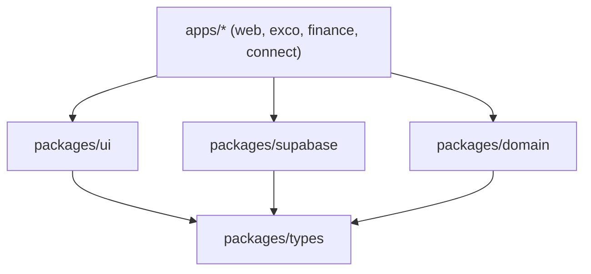

# Frontend conventions (standard)

> **Standard** — living convention for Shesa's frontend apps and packages.
> **Related ADRs:** [0010](../adr/0010-monorepo-package-layout-and-dep-direction.md), [0014](../adr/0014-tokens-in-httponly-cookie-no-localstorage.md), [0021](../adr/0021-monorepo-pnpm-turborepo.md), [0027](../adr/0027-utils-and-validators-packages.md), [0030](../adr/0030-supabase-as-baas-with-server-actions.md).

The standard every Shesa app and package follows. Written so a new dev can read one section and know exactly where code goes, what to name it, and why. Rules here are enforced by tooling ([§7](#7-enforcement)), not goodwill.

---

## 1. Package map & responsibilities

Apps and packages each own exactly one concern (SRP at the package level).

### Apps

| App           | Stack            | Purpose                                                              |
| ------------- | ---------------- | -------------------------------------------------------------------- |
| `apps/web`    | Next.js          | Public website + CMS                                                 |
| `apps/exco`   | React or Next.js | Governance dashboard for executive committees                        |
| `apps/finance`| React or Next.js | Finance application (charges, payments, treasury, reports, exceptions)|
| `apps/connect`| React or Next.js | Forums, jobs, achievements, live sessions, polls                     |

Stack per app is the call of whoever scaffolds it — Next.js when SEO / SSR / Server Actions help; plain React (Vite) when a single-page dashboard is enough.

### Packages

| Package              | Owns                                                                                          | Must NOT contain                                                |
| -------------------- | --------------------------------------------------------------------------------------------- | --------------------------------------------------------------- |
| `packages/ui`        | shadcn/ui components (copy-pasted in), Tailwind config, shared CSS variables, `cn()` helper   | Domain logic, Supabase imports, app-specific UX                 |
| `packages/types`     | Cross-package shared domain types (TypeScript)                                                | Runtime code                                                    |
| `packages/domain`    | Zod schemas, domain errors, business-rule helpers, policy module, generic utils & validators  | UI, Supabase client construction, app-specific code             |
| `packages/supabase`  | Supabase client factories (browser, server, service-role), generated DB types, RLS helpers    | UI, domain logic                                                |

### Where does a type live?

- A Supabase DB row shape → **generated**, comes from `packages/supabase` (`supabase gen types`). Never re-declare it.
- A domain concept used by 2+ packages (e.g. `MembershipStatus`) → `packages/types`.
- A type used only inside one component → next to the component.
- A type used only inside one app → that app's local `types/`.

---

## 2. Dependency direction

Imports flow **one way only — downward**. Enforced by `dependency-cruiser` in CI.

Hard rules:

- **No package imports an app.** Ever.
- **`packages/ui` must not import** `packages/supabase` or `packages/domain`. It stays presentational; data is passed in as props.
- **`packages/types` imports nothing.** It is the root of the type graph.
- **The Supabase service-role key is banned everywhere except Server Actions, Route Handlers, and Edge Functions.** Browser bundles ship the anon key only; RLS enforces access. Enforced by ESLint `no-restricted-imports` on the service-role client export.
- A package may only import packages strictly below it in the graph.

---

## 3. shadcn/ui — the component layer

We use **shadcn/ui's copy-paste model** — components live in `packages/ui/src/components/` after `pnpm shadcn add <component>`. They are our code; we own them, we adapt them.

- **Add a component:** `pnpm --filter @shesa/ui shadcn add button` (or whatever the runner alias becomes).
- **Customize:** edit the file in `packages/ui/src/components/` directly. Don't fork — just edit.
- **Tailwind config** lives in `packages/ui/tailwind.config.ts`; apps extend it via `presets:`. CSS variables for theming live in `packages/ui/src/styles/globals.css`.
- **Forms:** shadcn/ui Form + react-hook-form + Zod resolver, with schemas imported from `packages/domain/validators/`.

---

## 4. Atoms vs molecules vs app components

| Tier             | Lives in                | Knows about                                | Examples                                       |
| ---------------- | ----------------------- | ------------------------------------------ | ---------------------------------------------- |
| Atom / primitive | `packages/ui/components`| Nothing but its own props                  | Button, Input, Badge, Avatar (shadcn-shipped)  |
| Molecule         | `packages/ui/components`| Only atoms + light internal state          | Form, Dialog, Dropdown, Card, Tabs, DataTable  |
| App component    | the **app** (`apps/*`)  | Domain data, Supabase, routing             | MemberCard, ChargeRow, BranchSwitcher          |

Test for "does this belong in `packages/ui`?": _Could every Shesa app use it without knowing what a Member or a Charge is?_ If no — it's an app component.

---

## 5. Naming

| Thing            | Convention                                  | Example                             |
| ---------------- | ------------------------------------------- | ----------------------------------- |
| React component  | `PascalCase.tsx`, default export OR named   | `MemberCard.tsx`                    |
| Hook             | `useThing.ts`, camelCase                    | `useCurrentMember.ts`               |
| Server Action    | `verbResource.ts` or `actions.ts`           | `createCharge.ts`                   |
| Util             | camelCase, named export, pure               | `formatCurrency.ts`                 |
| Type file        | camelCase or PascalCase, grouped by domain  | `member.ts`                         |
| Folder           | kebab-case                                  | `member-profile/`                   |
| Package          | `@shesa/kebab-case`                         | `@shesa/ui`                         |
| Boolean prop     | `is` / `has` / `can` / `should`             | `isLoading`, `canSubmit`            |
| Interface / type | PascalCase, no `I` prefix                   | `Member`, not `IMember`             |
| Constant         | SCREAMING_SNAKE_CASE                        | `MAX_BULK_IMPORT_ROWS`              |
| CSS variable     | semantic, kebab-case                        | `--color-primary`, `--space-4`      |

---

## 6. SRP / DRY

- **One file, one responsibility.**
- **A component either presents or orchestrates, never both.** Atoms / molecules present. Data fetching, mutations, and policy live in hooks (for client) and Server Actions (for Next).
- Layering for Next apps: **Component → Server Action → supabase-js**. For React apps: **Component → TanStack Query hook → supabase-js**. A component never imports the Supabase client directly inside its body.
- **A package does one job.** New cross-cutting concern → consider a new package (and an ADR); don't bolt it onto an unrelated one.

DRY — single source of truth per concern:

| Concern               | Single source                                                         |
| --------------------- | --------------------------------------------------------------------- |
| DB row shapes         | `packages/supabase/types.gen.ts` (regenerated after migrations)       |
| API contracts         | Zod schemas in `packages/domain/validators/`                          |
| Domain types          | `packages/types/`                                                     |
| UI components         | `packages/ui/`                                                        |
| Currency / date format| `packages/domain/utils/`                                              |
| Permission checks     | `packages/domain/policy/`                                             |

**The senior caveat — don't over-DRY.** Three similar lines is cheaper than a premature abstraction. Rule of three: abstract on the *third* genuine repetition.

---

## 7. Enforcement

| Rule                                       | Enforced by                                                                  |
| ------------------------------------------ | ---------------------------------------------------------------------------- |
| Dependency direction (§2)                  | `dependency-cruiser` in CI — fails the build on illegal imports              |
| `packages/ui` not importing supabase/domain| ESLint `no-restricted-imports` scoped to `packages/ui`                        |
| Service-role key never in browser bundle   | ESLint `no-restricted-imports` on the service-role client export             |
| Lint & format consistency                  | shared config + lint-staged + husky pre-commit + GitHub Actions              |
| Type safety / no `any` drift               | `tsc --noEmit` in CI, TypeScript strict mode                                  |
| Naming / structure                         | Code review checklist + this document linked in every PR template            |

A rule with no automated check is a suggestion. Wire each row above into CI before the team grows past a handful of developers.
